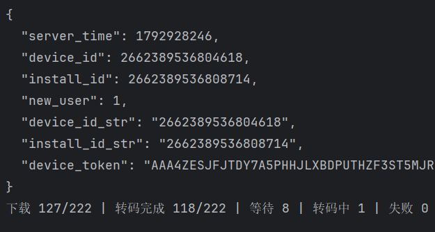
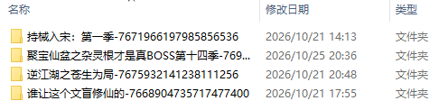
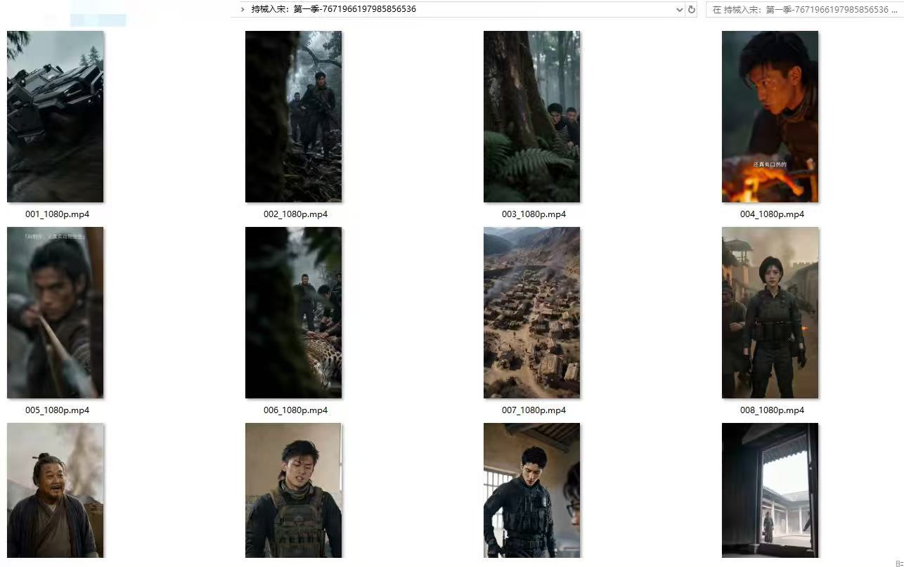
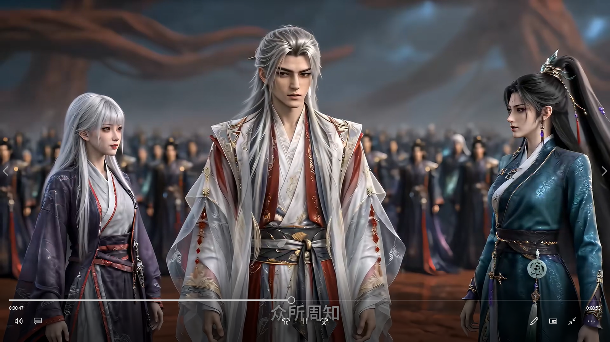

**语言 / Language：** [简体中文](./README.md) | [English](./README.en.md) | [日本語](./README.ja.md) | [한국어](./README.ko.md) | [Español](./README.es.md) | [Français](./README.fr.md)

# Hongguo Short Drama Collection · hongguo

A Hongguo short drama collection project showcasing device registration, video downloading and transcoding, downloaded drama folders, episode files, and local playback examples.

## Features and Examples

- **Device registration**: View the device and installation identifiers returned during registration.
- **Download and transcoding progress**: Track download counts, completed transcodes, and the number of queued, processing, and failed tasks.
- **Folders organized by drama**: Separate dramas using a folder naming pattern of “drama title + ID” for easy browsing and management.
- **Videos saved by episode**: Keep episode files in numerical order. The screenshots show filenames such as `001_1080p.mp4`.
- **Playback examples**: View local playback screenshots of live-action dramas and animated content.

## Screenshots

### 1. Device Registration and Video Downloading

The screenshot below shows the device registration response and download/transcoding progress. At the time of capture, the download count was `127/222`, with `118/222` transcodes completed, `8` tasks waiting, `1` transcoding, and `0` failures.

### 2. Downloaded Drama Folders

Each drama is saved in a separate folder whose name includes the drama title and its ID, making the collection easier to identify and organize.

### 3. Episode Files

Inside each drama folder, video files are arranged by episode number. The example below uses 《持械入宋：第一季》 and shows episode files such as `001_1080p.mp4` and `002_1080p.mp4`, along with their thumbnails.

### 4. Video Playback Examples

The following screenshots show local playback of downloaded videos, including their visuals and subtitles.

**Live-action drama**

**Animated content — example 1**

**Animated content — example 2**

## Contact

For project inquiries, technical discussions, or collaboration, please reach out through:

- **Instagram (ins)**: [@zhen.de.jia.de](https://www.instagram.com/zhen.de.jia.de/)
- **X (Twitter)**: [@szh06](https://x.com/szh06)
